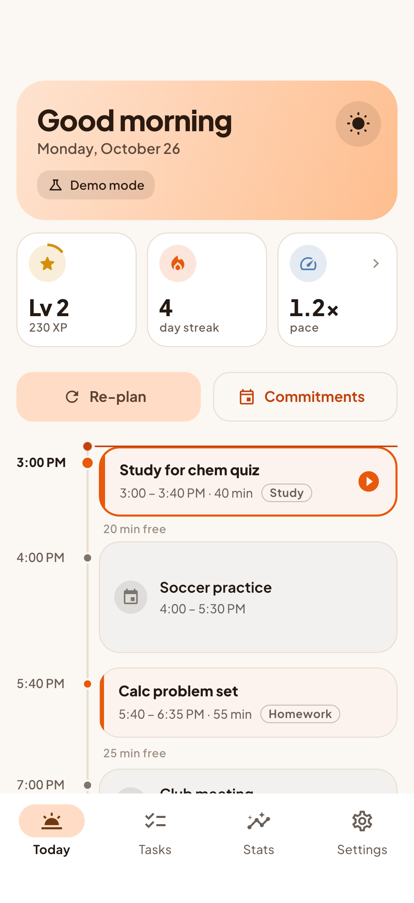
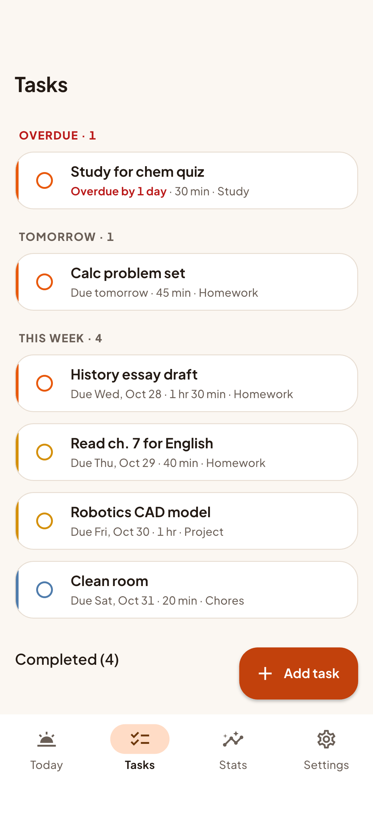
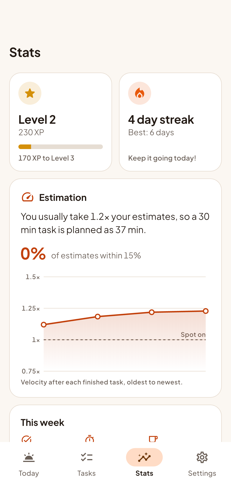

# Daybreak

**Plan the day before it plans you.**

I always underestimate how long my work takes, so I built Daybreak. It plans out your day based on your tasks and calendar, tracks how long you actually spend, and uses that to make better plans next time. Built with Flutter for the 2026 Congressional App Challenge.

## Features

- **Priority-based daily planning:** tap "Plan my day" and Daybreak fits your most important tasks into your free time, most urgent first
- **Pomodoro 50/10 scheduling:** work comes in focus sessions of up to 50 minutes with 10-minute breaks, even inside one long task
- **Commitments + phone calendar import:** block off practice, class, or work by hand, or pull today's events straight from your phone's calendar
- **Time logging with a timer:** start/pause/stop a timer (it keeps running if you leave the app) or just type in how long it took
- **Velocity learning:** Daybreak figures out if you usually run over (or under) your estimates and adjusts future plans
- **XP, levels, streaks, and badges:** earn XP for finishing tasks, a bonus for accurate estimates, keep a daily streak, and unlock badges like Early Bird and Sharpshooter
- **Stats screen:** your level, streak, estimation accuracy, a chart of your velocity over time, and this week's totals
- **Demo mode:** plan as if it's the start of your work window, so you can try it (or record a demo) at any hour, plus one-tap demo data

Everything stays on your phone. No account, no server, no internet needed.

## Screenshots

| Today | Tasks | Stats |
| --- | --- | --- |
|  |  |  |

## How it works

**Priority score.** Every task gets a score based on how important it is and how soon it's due: `10 × importance + 40 / (days until due + 1)`, plus 50 if it's overdue. So a High task due tomorrow scores 50, and an overdue Low task scores 100. Daybreak always schedules the highest scores first, so the stuff that actually matters today gets a spot.

**The planner.** Daybreak takes your work window (say 3:00 PM to 10:00 PM), cuts out your commitments plus a 10-minute buffer after each, and gets a list of free gaps. Then it drops each task into the earliest gap where it fits, as 50-minute focus sessions with 10-minute breaks in between. If a task is too big for any one gap, it gets split across gaps, and whatever still doesn't fit goes to a "Didn't fit today" list so it's first in line tomorrow.

**Velocity.** Every time you finish a task, Daybreak compares how long it really took to what you guessed. If you said 30 minutes and it took 42, that's 1.4×. It keeps a running average of that number (your "velocity") and, once it has 3 logs, uses it to stretch or shrink your estimates when planning. The plan gets more realistic the more you use it.

## Technical challenges

**Pomodoros across free gaps, in priority order.** The hard part of the planner is that three rules pull against each other: higher-priority tasks go first, work never runs more than 50 minutes without a break, and the day is chopped up by commitments. A task only "fits" a gap if its work *plus the breaks it needs* fits, and the 50-minute counter carries over from the task before it (a 30-minute task followed by a 40-minute one becomes 30 + 20, break, 20). Breaks only ever go between two pieces of work in the same gap, which is what guarantees there's never a pointless break right before a commitment or at the end of the night. When a task doesn't fit anywhere whole, each gap takes the biggest piece it can (at least 25 minutes), and leftovers under 10 minutes get attached to the previous piece instead of becoming tiny blocks. All of this is plain Dart with 30+ planner unit tests covering the tricky cases.

**Making velocity stable.** A naive average gets wrecked by one bad day, or by a timer you forgot to stop overnight. So velocity is an exponential moving average (`new = 0.3 × this log + 0.7 × old`), which follows your recent habits without overreacting. It's clamped between 0.5× and 3×, ratios above 5× or below 0.2× are thrown out as probably-broken timers, and it isn't applied at all until you have 3 real logs. Accuracy is always measured against your *original* estimate, so Daybreak is measuring your guesses, not its own adjusted plan.

## Tech stack

- [Flutter](https://flutter.dev) (Dart), Material 3 with a custom sunrise design system (`lib/theme/`: tokens, semantic colors, light + dark themes)
- [Plus Jakarta Sans](https://github.com/tokotype/PlusJakartaSans) font, bundled with the app (SIL Open Font License)
- [provider](https://pub.dev/packages/provider) for state management
- [hive](https://pub.dev/packages/hive) + [hive_flutter](https://pub.dev/packages/hive_flutter) for local storage (plain JSON maps, no code generation)
- [device_calendar_plus](https://pub.dev/packages/device_calendar_plus) for reading the phone calendar (iOS + Android)
- [intl](https://pub.dev/packages/intl) for dates and times, [uuid](https://pub.dev/packages/uuid) for IDs
- The velocity chart is drawn by hand with `CustomPainter` (no chart library)

## Project structure

```
lib/
  main.dart, app.dart        app setup, theme, intro → home
  models/                    Task, Commitment, PlannedBlock, TimeLog, UserStats, Settings...
  services/                  pure Dart logic: planner, scoring, velocity, gamification,
                             stats, calendar conversion, demo data, storage
  providers/                 ChangeNotifier state + ProgressController (logging/completing)
  screens/                   Today, Tasks, task form, log time sheet, Commitments, Stats,
                             Settings, onboarding
  widgets/                   timeline blocks, task tiles, velocity chart, dialogs...
test/                        unit + widget tests (200 of them)
integration_test/            drives the app on a simulator to capture screenshots
tool/generate_icon.py        draws the app icon
```

## How to run

You'll need [Flutter](https://docs.flutter.dev/get-started/install) installed, plus a simulator, an emulator, or Chrome.

```bash
flutter pub get
flutter run              # pick a device, or: flutter run -d chrome
```

First launch shows a short intro. Tap **Try with demo data** to load a sample week, or load it later from Settings.

To run the tests:

```bash
flutter test
```

To regenerate the app icon or README screenshots:

```bash
python3 tool/generate_icon.py && dart run flutter_launcher_icons
flutter drive --driver=test_driver/integration_test.dart \
  --target=integration_test/screenshots_test.dart -d <simulator>
```

## What's next

- **Google Calendar sign-in**, so calendar events sync on the web too, not just from the phone's calendar
- **Cloud sync** between your phone and laptop (optional, still private by default)
- **Notifications** when a focus session or break is about to start
- **Energy-aware planning**: put hard tasks where you focus best (some people are morning people, some aren't)
